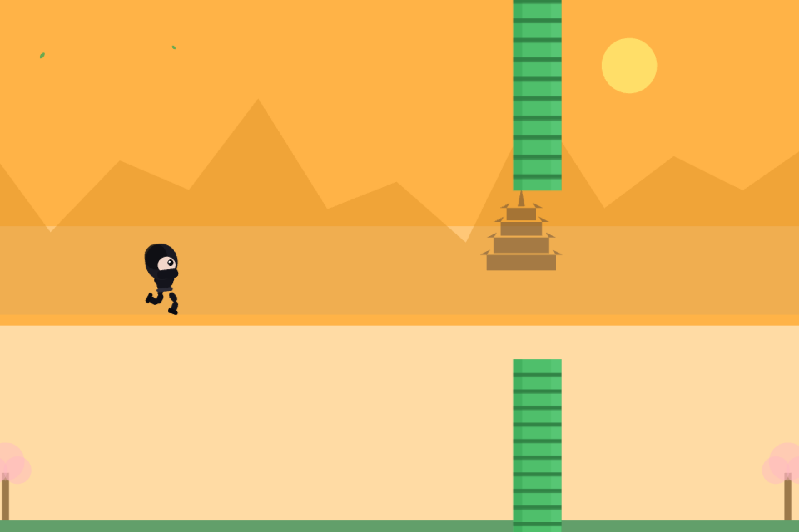

# Screensaver setup

Gutsy Shinobi has a silent, automatic screensaver mode and the original playable browser mode. The screensaver reuses the game's ninja, bamboo, scenery, wind, and sword mechanics. It cycles through all six palettes, restarts automatically, hides scores and prompts, shifts the composition slowly, and caps rendering at 30 FPS. It makes no network requests and loads no audio or personal leaderboard data.



Current browser and native previews are in the [screenshot gallery](screenshots/README.md). See the [security review](security-review.md) for tested behavior, privacy checks, and historical-content findings.

## Locking and sign-in

The native operating system starts and stops the screensaver and handles authentication. Configure the OS to require sign-in immediately when the screensaver starts. Moving the mouse or pressing a key dismisses the animation and returns to the OS sign-in flow. The game cannot be played while locked; use the browser version after signing in.

A browser preview, a manually launched `.scr /s`, or a fullscreen window does not lock a computer. This implementation does not replace the Windows lock-screen background, Windows secure sign-in desktop, macOS login window, or FileVault preboot display. Manually locking a device may show the platform's own lock screen instead of a third-party saver. Display sleep, managed device policy, and OS version determine whether/how long custom screensavers appear. No lock settings are weakened or changed by the builds.

References: [Apple ScreenSaverView](https://developer.apple.com/documentation/screensaver/screensaverview), [Apple password requirements](https://developer.apple.com/documentation/devicemanagement/screensaver), [Windows screen saver setup](https://support.microsoft.com/en-us/windows/configure-a-screen-saver-in-windows-a9dc2a0c-dc8e-9161-d270-aaccc252082a), [Windows screen saver behavior](https://learn.microsoft.com/en-us/windows/win32/lwef/screen-saver-library).

## Browser preview

```sh
cd frontend
npm ci --ignore-scripts
npm run dev
```

Open `http://127.0.0.1:5173/screensaver.html` for the animation or `/` to play. The preview stays open until the tab closes. Production web builds include both pages. Only the native hosts provide screensaver lifecycle and wake behavior.

## macOS 12 or later

Requires Xcode command-line build tools and Node.js 22.12+ (Node 24 LTS recommended).

From the repository root:

```sh
npm --prefix frontend ci --ignore-scripts
bash screensaver/macos/build.sh
```

The universal Intel/Apple Silicon bundle is `screensaver/build/macos/Gutsy Shinobi.saver`. Double-click the bundle and follow macOS installation prompts for your user. Select Gutsy Shinobi in System Settings > Screen Saver (the exact location varies by macOS version). Set an idle timeout and set System Settings > Lock Screen > Require password after screen saver begins or display is turned off to **Immediately**. Preview, then verify actual idle activation and sign-in on your macOS version.

The build comments describe the current prerequisites and local-only behavior. The build uses an ad-hoc signature for local testing. Distribution to other computers needs a Developer ID signature and Apple notarization. Set `CODESIGN_IDENTITY` to your signing identity to sign during the build; notarization and release packaging are separate release steps. The scripts do not install the saver, change settings, remove quarantine, or disable Gatekeeper. Remove the installed bundle from `~/Library/Screen Savers` to uninstall.

## Windows 11

Build on Windows with Node.js 22.12+ and the .NET 10 SDK. The generated package includes .NET; target machines need the Microsoft Edge WebView2 Evergreen Runtime. The runtime must already be installed; the saver does not download or install it. Windows 10 deployments require separate OS/runtime support and compatibility testing.

From PowerShell in the repository root:

```powershell
npm --prefix frontend ci --ignore-scripts
./screensaver/windows/build.ps1
# ARM64 machines:
./screensaver/windows/build.ps1 -Runtime win-arm64
```

Keep the entire output folder `screensaver/build/windows/win-x64` (or `win-arm64`) together, including the `Web` folder, native loader, managed assemblies, and runtime files. Copy the folder to a permanent location under your control. Do not copy just the `.scr` file. Right-click `GutsyShinobi.scr` > Install to open Windows Screen Saver Settings; select it, set the Wait time, and enable **On resume, display logon screen**. Verify idle activation and password protection. Do not use writable shared folders for an executable screensaver package.

Supported OS launch arguments:

- `/s`: full screen on every connected monitor; native key/button or mouse movement ends all windows.
- `/p HWND` or `/p:HWND`: embedded, resizing preview inside the Windows settings window.
- `/c` or `/c:HWND`: configuration information; no privileged operations.
- No arguments: configuration information. Unknown arguments and invalid preview handles exit.

To uninstall, choose another saver in Windows settings, then remove the package folder. Authenticode-sign the release package before distributing it. No machine-wide install or registry changes are performed by the build scripts.

## Verification

```sh
npm --prefix frontend run test:run
npm --prefix frontend run build
npm --prefix frontend run build:screensaver
dotnet run --project screensaver/tests/LaunchOptions.Tests.csproj
```

The current checks include 27 frontend tests and 21 Windows launch-argument cases. CI builds the macOS bundle and Windows x64/ARM64 packages and checks the frontend dependency audit. Before distributing, test the signed package on each target OS: settings preview (including small sizes), actual idle activation, immediate sign-in requirement, wake by mouse/keyboard, repeated starts/stops, multiple monitors, display sleep, and operation without network access. Windows secure-desktop behavior requires testing on Windows; cross-compilation cannot verify it.
