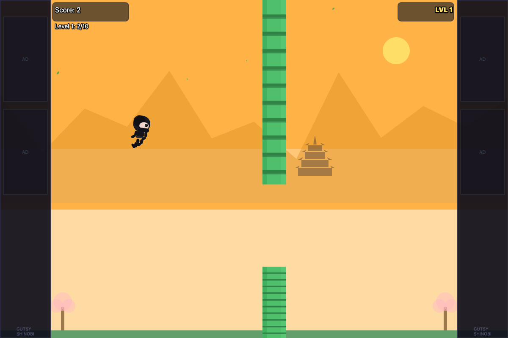
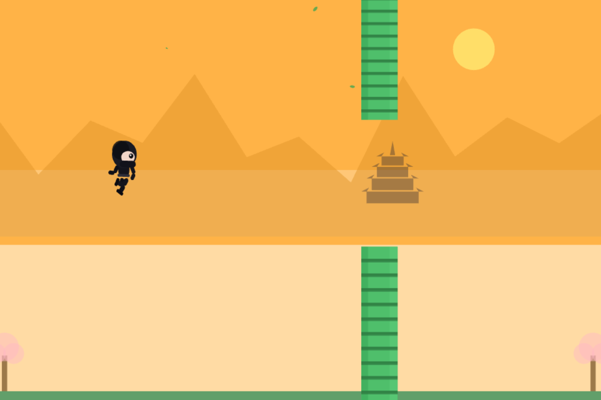
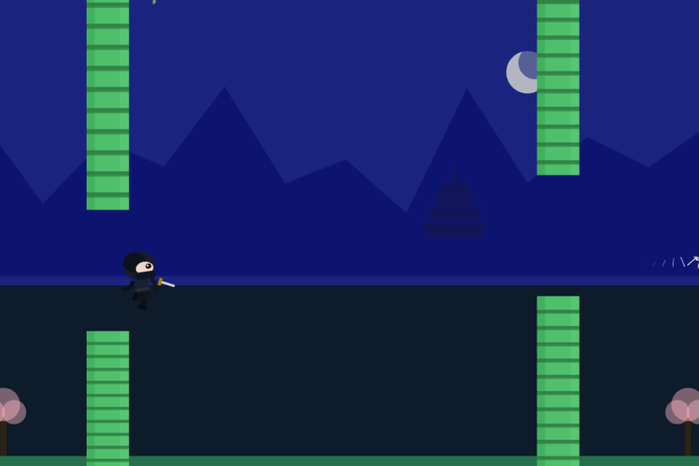

# Current screenshots

Captured on 2026-10-28 from the current implementation. Browser images use a fresh browser context with no saved leaderboard data, a 1200×800 viewport, and app content only. They contain no desktop, browser chrome, account names, or local filesystem paths. These are rendered screenshots, not design mockups.

## Browser gameplay

The browser game retains scores, level progress, and decorative ad placeholders. The placeholders load no advertising service. The real jump controller kept the run moving for capture; no high-score names were entered.

## Browser screensaver preview: dawn

Autoplay uses the shared scene without HUD, game input, audio, or leaderboard access. A browser preview does not lock the device.

## Browser screensaver preview: night

The capture selects the existing level 4 palette, then renders the normal automatic run. It demonstrates the moon and darker scenery without waiting for every preceding level.

## Native macOS preview

Captured from the built `.saver` bundle in a temporary native preview window. Only the webview content is included. This confirms packaged rendering, not password-on-resume or actual idle activation. No Windows runtime screenshot is claimed; Windows packages were cross-built on macOS.

To refresh this gallery, use a fresh local browser profile for both pages, capture only the app viewport, and avoid personal leaderboard data. For the native image, capture the installed or locally hosted bundle's content without the desktop. Review visible content and image metadata, then update the capture date and rerun the documented checks. See [the user guide](../user-guide.md), [native setup](../screensaver-guide.md), and [security review](../security-review.md).
